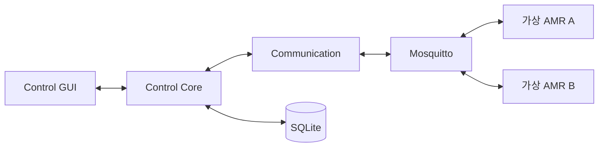
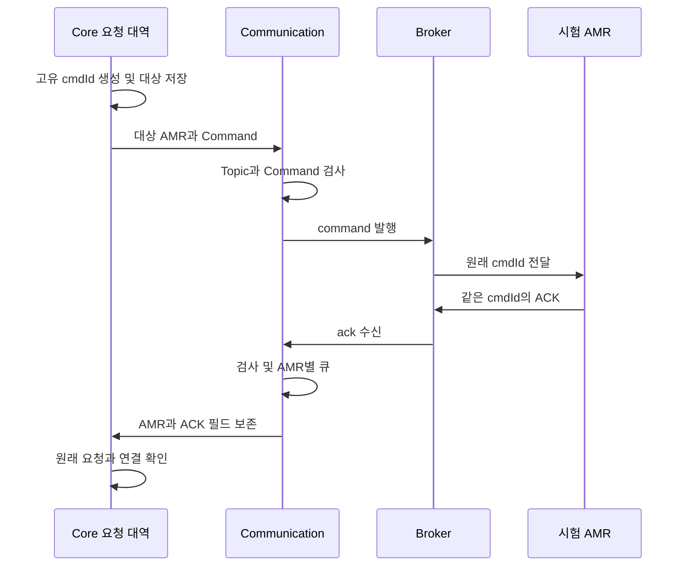

# AMR 관제 시스템 상세 설계

현재 연결점과 목표 컴포넌트를 구분한다. 동작은 개정0.3 [기능명세](../full/feature_spec.md), 논리 데이터는 [공통 계약](../full/interface_contract.md), 미정 정책은 [PDF 비교서](../full/pdf_comparison.md)의 P-01~21을 따른다. 아래 실제 코드 연결점은 기존 저장소 안내이며 신규 구현의 클래스명을 강제하지 않는다. 목표 그림은 책임 설계이며 모든 컴포넌트가 구현됐다는 의미가 아니다.

## 1. 현재 실행 구조

TestClient는 Heartbeat 발행·Command 수신·실패 ACK 반환을 한다. Communication은 Telemetry/Alarm도 받지만 현재 그 시험 발행자는 진단 도구다. WPF 실험 프로젝트는 실제 Core/GUI 통합을 대신하지 않는다.

## 2. 목표 구조와 책임

| 컴포넌트 | 책임 | 경계 |
| --- | --- | --- |
| GUI | 입력·위치·상태·장애·결과·이력 표시 | Core만 호출 |
| Core | 등록·업무 상태·요청/결과·저장 조정 | wire 검증·이동 계산은 위임 |
| Communication | 연결·검증·송수신·큐·생존 감시 | 운행 상태·업무 성공 임의 결정 없음 |
| 가상 AMR | 설정·이동·장애·상태·결과 생성 | 실제 내부 상태에 맞게 발행 |
| SQLite | Core 데이터 저장·조회 | GUI 직접 접근 없음 |
| Broker | MQTT 중계 | 업무 판정·명령 실행 담당 아님 |

## 3. 수신과 동시성

MQTT 콜백은 수신 시각을 캡처하고 Topic·Payload를 검사한다. 유효 메시지만 AMR별 큐로 전달한다. 정상 Heartbeat는 큐 대기 전 별도 모니터 시각을 갱신한다.

같은 AMR의 네 유형은 한 Channel 소비자가 순차 처리한다. 서로 다른 AMR의 Core 호출은 동시에 진행된다. 기본256대기/64AMR 초과 시 새 메시지를 거부·기록한다. QueueFull 정상 Heartbeat는 생존 시각을 갱신한다.

입력 오류·큐/처리 오류·업무 History는 별개다. 종료 시 새 수신 차단·취소·대기 폐기·종료 대기를 수행한다. [큐 계약](../../src/Amr.Communication/Mqtt/RECEIVE_QUEUE.md)과 [실행 흐름도](../../src/Amr.Communication/Mqtt/RECEIVE_FLOW.md)를 따른다.

## 4. 명령과 결과

COM-05 검증 목표다. 기본 왕복은 존재하지만 요청 보관·역순 응답 전체 검증은 미착수다. 실제 Core의 업무 상태·ACK Timeout·중복 정책은 후속이다.

## 5. 실제 코드 인터페이스

| 연결점 | 위치 | 계약 |
| --- | --- | --- |
| 명령 발행 | [MqttPublisher](../../src/Amr.Communication/Mqtt/MqttPublisher.cs) | PublishCommandAsync(amrId, payload, cancellationToken) |
| 정상 전달 | [IIncomingMessageSink](../../src/Amr.Communication/Validation/IncomingMessageProcessor.cs) | ReceiveAsync(IncomingMessage, CancellationToken) |
| 검증 오류 | 같은 파일의 IValidationLog | Rejected(ValidationFailureLog) |
| 처리 오류 | [IMessageProcessingLog](../../src/Amr.Communication/Validation/MessageProcessingLog.cs) | 큐 제한·Core 실패 코드·이유 |
| 감시 알림 | [HeartbeatNotification](../../src/Amr.Communication/Monitoring/HeartbeatNotification.cs) | AMR·유형·수신/관측 시각·경과/제한 시간 |
| AMR 명령 대역 | [BasicCommandHandler](../../src/Amr.TestClient/BasicCommandHandler.cs) | 원래 ID의 FAILURE, 유효 ID가 없으면 ACK 없음 |

새 Core·GUI·저장소 API는 해당 단계에서 정의한다. 아직 없는 메서드를 현재 호출 가능한 것으로 표시하지 않는다.

## 6. 상태와 시간

운행 상태, Broker 연결, Heartbeat 감시, 명령 업무 상태를 분리한다. 현재 Heartbeat는 최초 정상 수신부터 단조 시계로 계산한다. Payload ts·PC 시계 변경은 판정에 쓰지 않고, 전달·표시는 UTC Unix milliseconds Int64를 사용한다.

Core는 이후 등록 장비의 미수신·Offline 정책을 추가해야 한다. 미등록 Telemetry, 과거 ts 상태 반영, 중복 ACK, 재시작 복원은 미정이며 파서에 업무 정책을 넣지 않는다.

## 7. 메시지와 저장 계약

wire 표는 기능명세서를 참조한다. 세부 기준은 [수신](../../src/Amr.Communication/Validation/CONTRACT.md), [Command](../../src/Amr.Communication/Command/CONTRACT.md), [감시](../../src/Amr.Communication/Monitoring/CONTRACT.md) 계약이다.

SQLite 스키마는 미정이다. 후보는 장비 등록·명령 요청/결과·Alarm 이력이며 Telemetry 전체 보관·주기·기간은 별도 결정한다. 단순 수신 로그가 자동으로 업무 History가 되지 않는다.

## 8. 폴더와 의존성

src/제품, tests/테스트·대역, tools/도구, evidence/증거를 유지한다. 문서는 docs/mvp·full·guides·reports·study·history로 구분하고 docs/README.md에서 안내한다. 기존 솔루션·진입점은 루트에 둔다. 후속 Core/저장소 프로젝트 분리는 의존 방향·솔루션 변경 검증 후 수행한다.

## 9. 장애와 검증

| 상황 | 처리 | 검증 |
| --- | --- | --- |
| JSON·필드 오류 | 현재 로그·폐기·계속 수신 | COM-04 단위·실제 MQTT |
| 느린 Core·포화 | 현재 독립 큐·신규 거부·Heartbeat 별도 갱신 | 제어 가능한 대역·실제 Broker |
| AMR 생존 중단 | 현재 Timeout·복구 | 제어 시계·두 AMR |
| Broker 단절 | 현재 감지·종료, 자동 복구 후속 | COM-03·향후 SC-005 |
| ACK 역순 | 기본 전달 존재, 전체 연결 COM-05 예정 | 요청 목록과 단계별 기록 |
| 이동·장애·저장 실패 | 시뮬레이션·Core 정책 후속 | 상태·ACK·Telemetry·Alarm·DB 통합 |

표준 검사와 실제 Broker 검증의 역할을 구분한다. Mermaid 그림은 설계 산출물이며 제품 실행 증거가 아니다.
