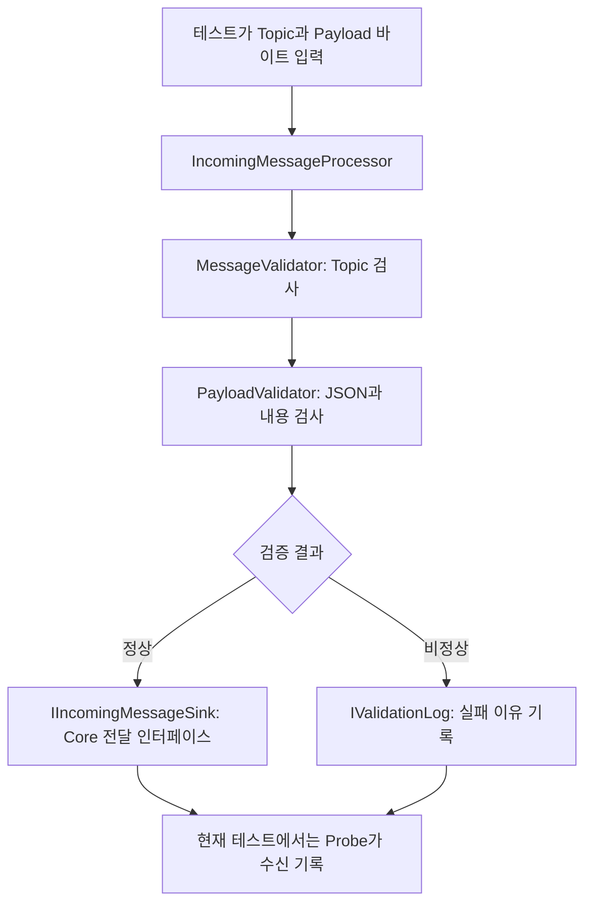

# AMR 프로젝트 공부 안내서

이 문서는 **지금 있는 코드가 왜 이렇게 나뉘었는지, 무엇부터 공부해야 하는지, 테스트가 무엇을 근거로 검사하는지** 설명한다. C#과 테스트 코드에 익숙하지 않은 상태를 기준으로 작성했다.

작성 기준: S010 학습 안내에 S016(2026-09-29) PDF 반영 계약 v2를 보완했다. 최신 기능 상태는 추적기를 따른다. S015부터 실제 Heartbeat 구독 경로가 연결되어 있으며 다른 유형과 큐는 미완료다. 이 문서는 학습 안내이며 요구사항의 기준은 [feature_list.json](../../feature_list.json), 실제 검증 이력은 [claude-progress.md](../../claude-progress.md)다.

## 1. 지금 가장 중요한 한 가지

**외부에서 온 메시지는 검사한 뒤에만 Core로 넘긴다. 잘못된 메시지 하나 때문에 다음 정상 메시지까지 막히면 안 된다.**

이 규칙을 코드와 테스트 양쪽에서 설명할 수 있게 되는 것이 첫 번째 목표다.

| 입력 | Core에 전달 | 실패 로그 | 다음 정상 메시지 |
| --- | --- | --- | --- |
| 계약에 맞는 메시지 | 1회 | 없음 | 계속 처리 |
| 필수 필드 누락·잘못된 값 | 0회 | 이유를 1회 기록 | 계속 처리 |
| 형식이 올바른 `FAILURE` ACK | 1회 | 검증 실패 로그 없음 | 계속 처리 |

마지막 행이 중요하다. **로봇이 “명령 수행 실패”라고 정상적으로 보고한 것**과 **메시지 자체가 잘못된 것**은 다르다. 전자는 Core가 업무 결과를 판단할 수 있도록 전달해야 한다.

먼저 [IncomingMessageProcessor.cs](../../src/Amr.Communication/Validation/IncomingMessageProcessor.cs)의 `ProcessAsync`와 [MessageValidationTests.cs](../../tests/Amr.Communication.Tests/MessageValidationTests.cs)의 `Reject`를 함께 읽는다. 이 두 메서드가 위 표를 가장 짧게 보여준다.

## 2. 이 프로젝트가 하는 일과 현재 구현 범위

AMR은 자율 이동 로봇이다. 이 프로젝트는 가상 AMR의 메시지를 받고 명령을 보내는 통신 부분부터 만들고 있다.

| 용어 | 이 프로젝트에서의 뜻 |
| --- | --- |
| MQTT | 메시지를 발행하고 구독하는 통신 방식 |
| Broker | 메시지를 받아 구독자에게 전달하는 중간 서버. 개발 환경에서는 Mosquitto 사용 |
| Topic | 메시지를 구분하는 주소 같은 문자열. 예: `amr/AMR_001/heartbeat` |
| Payload | 메시지의 실제 내용. 여기서는 JSON을 UTF-8 바이트로 표현 |
| Communication | Broker 연결과 수신 메시지 검증 등을 맡는 통신 계층 |
| Core | 장비·명령·업무 상태를 판단할 핵심 로직. 현재 COM-04에서는 인터페이스와 테스트 대역만 사용 |
| GUI | 사용자가 보는 화면. 현재 WPF 코드는 실험용 |
| Telemetry | 로봇의 위치·속도·상태 같은 정보 |
| Alarm | 로봇이 보고하는 알림·경고·오류 |
| Heartbeat | 개별 로봇이 주기적으로 보내는 생존 메시지 |
| ACK | 명령에 대한 응답. `cmdId`로 어느 명령의 응답인지 구분 |

현재 연결된 코드 흐름은 두 가지로 나누어 이해한다.

**COM-03: 실제 Broker 연결 경로**

```text
통신 Console의 Program.cs
  → MqttConnectionManager: 연결 상태와 수명 관리
  → MqttClientService: MQTTnet 호출
  → 실제 Mosquitto Broker
```

**COM-04: 테스트에서 직접 실행하는 메시지 검증 경로**



Topic 단계에서 실패해도 같은 실패 기록 경로로 돌아온다. S015부터 `init.cmd start`는 실제 Heartbeat를 구독해 이 검증 경로와 콘솔 Core 대역으로 전달한다. Telemetry·Alarm·ACK 및 AMR별 큐는 COM-01 후속이며 네 유형의 검증기는 테스트에서 직접 호출한다.

| 기능 | 현재 상태 | 확인한 범위 |
| --- | --- | --- |
| COM-03 | 구현·검증 완료 | 실제 Broker 연결, 연결 유지, 단절·최초 실패 감지 |
| COM-04 | 내부 임시 계약으로 구현·검증 완료 | 메시지 검증, Core 대역 전달, 실패 로그 대역 기록 |
| COM-01 | 부분 구현 | Heartbeat 구독·검증 연결 완료. 다른 유형·명령·AMR별 큐는 후속 |
| COM-02 | 미구현 | AMR별 마지막 정상 Heartbeat 수신 시각과 Timeout 관리 |
| COM-05 | 미구현 | 실제 Command/ACK 송수신 과정에서 CommandId 보존 |

## 3. 공부 우선순위 — 무엇을 꼭 알아야 하나

### 1순위: 입력 검증과 요구사항 읽기

공부할 내용은 JSON object/string/number/null 구분, 필수 필드, 허용 값, 경계값이다. **JSON이 문법상 올바르다는 것만으로 정상 메시지가 되지는 않는다.**

예를 들어 `{"id":"AMR_001","ts":"123"}`는 올바른 JSON이지만, `ts`가 문자열이어서 현재 계약을 위반한다. `ts: 123`과 `ts: "123"`은 다르다.

읽을 곳: [CONTRACT.md](../../src/Amr.Communication/Validation/CONTRACT.md) → [MessageValidator.cs](../../src/Amr.Communication/Validation/MessageValidator.cs) → [PayloadValidator.cs](../../src/Amr.Communication/Validation/PayloadValidator.cs).

이해 확인: “ACK에는 id가 없어도 되는데 Heartbeat에는 왜 반드시 있어야 하는가?”에 **현재 계약이 그렇게 정했고 코드와 테스트가 그 계약을 따르기 때문**이라고 답할 수 있어야 한다. 외부 장비의 보편적 규칙이라고 암기하지 않는다.

### 2순위: 인터페이스와 테스트 대역

`interface`는 구현 방법 대신 “어떤 호출을 받을 수 있는지” 정한다. 생성자로 구현 객체를 전달하는 방식을 여기서는 의존성 주입이라고 부른다. 별도의 DI 프레임워크 없이도 가능하다.

| 인터페이스 | 실제 역할 | 테스트에서 대신하는 객체 |
| --- | --- | --- |
| `IIncomingMessageSink` | 검증한 메시지를 Core 쪽에 전달 | `Probe`: 받은 메시지를 리스트에 저장 |
| `IValidationLog` | 입력 검증 실패를 기록 | `Probe`: 실패 정보를 리스트에 저장 |
| `IBrokerClient` | 연결·해제·단절 알림의 통신 경계 | `FakeClient`: 성공·실패·지연·끊김을 의도적으로 발생 |

실제 Core가 아직 없어도 `Probe.Messages.Count`를 검사하면 “전달하면 안 되는 메시지가 전달됐는지” 확인할 수 있다. 하지만 실제 Core가 올바르게 업무를 처리하는지는 이 테스트로 알 수 없다.

읽을 곳: [IncomingMessageProcessor.cs](../../src/Amr.Communication/Validation/IncomingMessageProcessor.cs)의 생성자와 인터페이스, [MessageValidationTests.cs](../../tests/Amr.Communication.Tests/MessageValidationTests.cs)의 `Probe`, [IBrokerClient.cs](../../src/Amr.Communication/Mqtt/IBrokerClient.cs).

### 3순위: 테스트의 입력·실행·기대 결과

테스트를 읽을 때 다음 세 가지를 먼저 표시한다.

1. **준비(Arrange)**: 어떤 입력과 대역을 준비했나?
2. **실행(Act)**: 실제 제품의 어느 메서드를 호출했나?
3. **검증(Assert)**: 어떤 결과가 나와야 통과하나?

`Assert.True(result.IsValid)`만 보면 놓치는 것이 있다. 정상 메시지는 **Core 전달 횟수와 전달한 내용**도 확인해야 한다. 비정상 메시지는 **Core 미전달, 이유 로그, 다음 정상 입력의 처리**까지 확인해야 한다.

읽을 곳: [MessageValidationTests.cs](../../tests/Amr.Communication.Tests/MessageValidationTests.cs)의 `NormalMessagesPreserveAllFieldsAtCoreBoundary`, `EveryRequiredFieldMustBePresent`, `Reject`.

### 4순위: async/await, 취소, 자원 정리

통신에는 기다리는 시간이 있다. `Task`는 작업의 완료를 표현하며, `await`는 완료 후 이어서 실행하게 한다. **async를 붙였다고 자동으로 새 스레드가 생기거나 모든 일이 동시에 실행되는 것은 아니다.**

| 문법·도구 | 이 코드에서 하는 일 |
| --- | --- |
| `Task<bool>` | 연결 작업 완료 후 성공 여부를 반환 |
| `ValueTask` | 메시지 수신·해제 API의 비동기 완료 표현. 처음에는 호출부에서 `await`하는 법부터 익힌다 |
| `CancellationToken` | 작업에 취소 요청을 전달. 강제 종료 장치가 아니라 호출받은 쪽이 확인하는 신호 |
| `CreateLinkedTokenSource` | 호출자 취소와 내부 제한 시간 취소를 한 토큰으로 전달할 준비 |
| `CancelAfter` | 정해진 시간이 지나면 취소를 요청 |
| `using` / `await using` | 사용이 끝나면 동기/비동기 해제 메서드를 호출 |
| `try/finally` | 성공·실패와 관계없이 잠금 해제 등 마무리 수행 |
| `ConfigureAwait(false)` | await 이후 기존 실행 컨텍스트로 복귀할 필요가 없음을 표시. 새 스레드 생성이나 병렬 처리 명령이 아님 |

읽을 곳: [MqttConnectionManager.cs](../../src/Amr.Communication/Mqtt/MqttConnectionManager.cs)의 `ConnectAsync`, `DisconnectCoreAsync`, `DisposeAsync`. 대응 테스트는 `TimeoutReturnsFailureAndReleasesResources`, `CallerCancellationIsDistinctFromFailure`다.

### 5순위: 연결 상태와 동시성

상태 변화는 보통 `Disconnected → Connecting → Connected → Disconnecting → Disconnected`다. 예상하지 못한 끊김은 `Faulted`로 처리하며, 현재 자동 재접속은 없다.

- `SemaphoreSlim(1, 1)`은 연결·해제 요청이 서로 겹치지 않게 비동기 대기를 제공한다.
- `lock (_stateLock)`은 현재 클라이언트와 상태를 읽거나 바꾸는 짧은 구간을 보호한다. 네트워크 대기 전체를 이 lock 안에서 수행하지 않는다.
- `ReferenceEquals(source, _client)`는 알림을 보낸 객체가 **지금 연결에 사용하는 객체인지** 확인한다. 이전 연결에서 늦게 도착한 끊김 알림이 새 연결을 망가뜨리는 것을 막는다.
- `StateChanged` 이벤트 수신자는 짧게 처리해야 한다. 이 콜백에서 연결 메서드를 `.Wait()`나 `.Result`로 동기 대기하면 교착 위험이 있다.

읽을 곳: [MqttConnectionManager.cs](../../src/Amr.Communication/Mqtt/MqttConnectionManager.cs)의 `OnDisconnected`, [ConnectionLifecycleTests.cs](../../tests/Amr.Communication.Tests/ConnectionLifecycleTests.cs)의 `ConcurrentConnectsDoNotDuplicateSessions`, `FailedConnectionAndLateCallbackCannotFaultExplicitRetry`.

### 6순위: 시간 단위와 두 종류의 생존 확인

`long`은 C#의 `Int64`, 즉 64비트 정수다. 현재 수신 계약의 `ts`는 **Unix milliseconds**이며 숫자가 크다고 오류로 처리하지 않는다. `int`의 범위는 약 ±21억이므로 현재 시각을 밀리초로 담기에 부족하다. 흔히 말하는 2038년 문제는 signed 32비트 **초** 표현과 관련되므로 초와 밀리초를 섞어 이해하지 않는다.

| 비교 | MQTT KeepAlive | AMR Heartbeat |
| --- | --- | --- |
| 확인 대상 | 클라이언트와 Broker 사이 연결 | 개별 AMR의 정상 메시지 수신 |
| 현재 담당 | COM-03, MQTTnet의 KeepAlive 동작 | COM-02에서 구현 예정 |
| 주의점 | Broker 연결이 살아 있다고 모든 로봇이 정상인 것은 아님 | Payload의 `ts` 대신 마지막 정상 **수신 시각**으로 Timeout을 판단해야 함 |

읽을 곳: [BrokerConnectionOptions.cs](../../src/Amr.Communication/Mqtt/BrokerConnectionOptions.cs), [HeartbeatMessage.cs](../../src/Amr.Communication/Models/HeartbeatMessage.cs), `Int64TimestampsArePreservedWithoutDateConversion` 테스트.

## 4. 파일 구성 — 어디에 무엇이 들어 있나

### 루트와 폴더

| 경로 | 역할 | 공부할 때의 사용법 |
| --- | --- | --- |
| [README.md](../guides/development.md) | 시작·검증 명령과 준비 도구 | 처음 실행할 때 |
| [AGENTS.md](../../AGENTS.md) | 작업·검증·기록 규칙 | 기능 수정 전 작업 범위 확인 |
| [feature_list.json](../../feature_list.json) | 기능별 요구사항, 상태, 설계 결정, 증거 | 테스트가 무엇을 보장해야 하는지 확인 |
| [claude-progress.md](../../claude-progress.md) | 실제 수행한 작업과 다음 할 일 | 최신 상태 확인 |
| [AmrControlSystem.slnx](../../AmrControlSystem.slnx) | 여러 프로젝트를 묶는 솔루션 목록 | 어떤 프로젝트들이 같이 빌드되는지 확인 |
| [global.json](../../global.json) | 사용할 .NET SDK 기준 | 환경 문제를 볼 때 |
| [init.cmd](../../init.cmd) | Windows 실행 입구 | 보통 이 파일을 통해 실행 |
| [init.ps1](../../init.ps1) | 복원·빌드·검사·테스트의 실제 공통 절차 | 검증 단계가 궁금할 때 |
| [init.sh](../../init.sh) | Git Bash에서 같은 PowerShell 절차를 호출 | Bash 환경에서 실행할 때 |
| [src](../../src) | 제품·실험 앱 소스 | 실제 동작 읽기 |
| [tests](../../tests) | 자동 테스트와 대역 | 기대 동작과 실패 조건 읽기 |
| [tools](../../tools) | 개발 검증 도구 | 테스트 결과를 어떻게 판정하는지 읽기 |
| [evidence](../../evidence) | 과거 실행 로그·TRX·결과 | “실제로 실행했는가?” 확인 |
| 각 프로젝트의 `obj/` | 복원 정보·자동 생성 코드 등 빌드 중간 산출물 | 학습용 원본 코드가 아니므로 우선 읽지 않아도 됨 |
| 각 프로젝트의 `bin/` | 빌드된 DLL·실행 산출물 | 실행 결과물. 직접 소스 수정하는 곳이 아님 |

`.cs`는 C# 코드, `.csproj`는 한 프로젝트의 대상 .NET·패키지·프로젝트 참조 설정이다. `.slnx`가 여러 `.csproj`를 묶는다. `bin/obj`는 일반적으로 Git에서 제외하며 실행 중이 아닐 때 지워도 다음 복원·빌드에서 필요한 파일을 다시 만든다.

### COM-04 핵심 파일

| 파일 | 역할 | 먼저 볼 부분 |
| --- | --- | --- |
| [Validation/CONTRACT.md](../../src/Amr.Communication/Validation/CONTRACT.md) | 현재 사용할 내부 메시지 규칙 | 필수 필드 표와 오류 정책 |
| [IncomingMessageProcessor.cs](../../src/Amr.Communication/Validation/IncomingMessageProcessor.cs) | 검사 후 Core 전달 또는 실패 로그 기록 | `ProcessAsync`, 두 인터페이스 |
| [MessageValidator.cs](../../src/Amr.Communication/Validation/MessageValidator.cs) | Topic 구조·ID 형식·유형 검사 | `Validate`, `IsValidId` |
| [PayloadValidator.cs](../../src/Amr.Communication/Validation/PayloadValidator.cs) | 바이트·JSON·필드·값 검사 및 모델 생성 | `Validate` 다음 `Object`, `Required`, `Text`, `Number` |
| [ValidationResult.cs](../../src/Amr.Communication/Validation/ValidationResult.cs) | 성공 메시지 또는 실패 정보를 반환 | `IsValid`, `Message`, `Error` |
| [IncomingMessage.cs](../../src/Amr.Communication/Models/IncomingMessage.cs) | 수신 모델 공통 부분 | AMR ID, 시간, `Kind` |
| [TelemetryMessage.cs](../../src/Amr.Communication/Models/TelemetryMessage.cs) | 위치·속도·상태 모델 | `TelemetryPosition`, `AmrState` |
| [AlarmMessage.cs](../../src/Amr.Communication/Models/AlarmMessage.cs) | 알람 코드·수준·내용 모델 | `AlarmLevel`, `Code`, `Message` |
| [HeartbeatMessage.cs](../../src/Amr.Communication/Models/HeartbeatMessage.cs) | 로봇 ID·시간 모델 | 별도 Timeout 판단이 없다는 점 |
| [AckMessage.cs](../../src/Amr.Communication/Models/AckMessage.cs) | 명령 ID와 성공·실패 결과 | `CommandId`, `AckResult` |
| [TelemetryPayLoad.cs](../../src/Amr.Communication/Models/TelemetryPayLoad.cs) | 기존 실험용 `TelemetryPayload`·`PositionData` | 새 `TelemetryMessage` 검증 경로와 구분 |

`record`는 데이터 중심 타입이며 값 비교를 제공한다. 현재 모델은 생성 뒤 기존 값을 일반 setter로 바꾸는 용도가 아니다. 다만 **record를 쓴다는 이유만으로 내부의 모든 객체까지 자동으로 불변이 되는 것은 아니다.** 현재 위치 모델도 record로 구성되어 있다.

### COM-03 연결 파일

| 파일 | 역할 | 핵심 읽기 포인트 |
| --- | --- | --- |
| [Console/Program.cs](../../src/Amr.Communication.Console/Program.cs) | 설정 읽기, 연결 시작, 상태 출력, 종료 | `await using`, `StateChanged`, `ConnectAsync` |
| [BrokerConnectionOptions.cs](../../src/Amr.Communication/Mqtt/BrokerConnectionOptions.cs) | 주소·포트·KeepAlive·Timeout·인증 설정 | 기본값과 `Validate` |
| [BrokerConnectionSnapshot.cs](../../src/Amr.Communication/Mqtt/BrokerConnectionSnapshot.cs) | 상태·이유·시간·오류를 묶은 알림 데이터 | `BrokerConnectionState` enum |
| [IBrokerClient.cs](../../src/Amr.Communication/Mqtt/IBrokerClient.cs) | 연결 수단을 추상화한 내부 인터페이스 | 실제 MQTT와 FakeClient 교체 지점 |
| [MqttClientService.cs](../../src/Amr.Communication/Mqtt/MqttClientService.cs) | MQTTnet 실제 호출과 이벤트 변환 | 옵션 Builder, 연결 결과 확인, 이벤트 해제 |
| [MqttConnectionManager.cs](../../src/Amr.Communication/Mqtt/MqttConnectionManager.cs) | 연결 요청 순서·상태·취소·해제 관리 | semaphore/lock, 이전 연결 알림 무시 |

`MqttClientService`는 실제 통신 라이브러리를 호출하고, `MqttConnectionManager`는 그 호출을 언제 하고 상태를 어떻게 관리할지 결정한다. 두 역할을 나눴기 때문에 실제 Broker 없이도 Manager의 상태 처리를 테스트할 수 있다.

### 아직 골격이거나 다음 작업에서 정리할 파일

| 파일 | 현재 상태 |
| --- | --- |
| [MqttSubscriber.cs](../../src/Amr.Communication/Mqtt/MqttSubscriber.cs) | Heartbeat 구독 및 검증기 전달 구현. 다른 유형·AMR별 큐는 후속 |
| [MqttPublisher.cs](../../src/Amr.Communication/Mqtt/MqttPublisher.cs) | 발행 기능 골격 |
| [MqttTopics.cs](../../src/Amr.Communication/Mqtt/MqttTopics.cs) | 기존 문자열 정의. `cmd/ack`, `cmd`, `state`가 현재 추적기와 다름 |
| [HeartbeatMonitor.cs](../../src/Amr.Communication/Monitoring/HeartbeatMonitor.cs) | 개별 AMR 감시 미구현 |
| [AmrConnectionState.cs](../../src/Amr.Communication/Monitoring/AmrConnectionState.cs) | 개별 AMR 상태 골격. BrokerConnectionSnapshot과 별개 |
| [CommandManager.cs](../../src/Amr.Communication/Command/CommandManager.cs) | 명령 관련 골격 |
| [CommandMessage.cs](../../src/Amr.Communication/Models/CommandMessage.cs), [MqttAliveMessage.cs](../../src/Amr.Communication/Models/MqttAliveMessage.cs) | 아직 데이터 계약·동작이 구현되지 않은 골격 |
| [Amr.TestClient/Program.cs](../../src/Amr.TestClient/Program.cs) | Heartbeat 발행 실습. S016부터 status=OK 포함; 이동·명령 처리는 후속 |
| [AmrControlSystem/MainWindow.xaml.cs](../../src/AmrControlSystem/MainWindow.xaml.cs) | 차트·MQTT·SQLite 등 실험 코드. GUI가 직접 MQTT/DB에 접근하는 기존 구조 |
| [AmrControlTest/MainWindow.xaml.cs](../../src/AmrControlTest/MainWindow.xaml.cs), [MqttTestService.cs](../../src/AmrControlTest/Tests/MqttTestService.cs), [LoggingTestService.cs](../../src/AmrControlTest/Tests/LoggingTestService.cs) | 별도의 WPF 실험 앱·보조 코드. tests/ 아래 xUnit 자동 테스트와 구분 |

WPF의 `MainWindow.xaml`은 화면 배치, `MainWindow.xaml.cs`는 화면 이벤트 코드, `App.xaml`·`App.xaml.cs`는 앱 시작 설정과 코드다. 먼저 통신 흐름을 익힌 뒤 본다. 현재 GUI 코드를 최종 계층 분리의 모범으로 그대로 따라 만들면 안 된다.

### 실행 환경과 검증 도구

| 파일 | 역할 |
| --- | --- |
| [docker-compose.yml](../../docker/docker-compose.yml) | 개발 Mosquitto와 Seq 서비스 설정. `init.cmd broker`는 Mosquitto를 시작 |
| [mosquitto.conf](../../docker/mosquitto/config/mosquitto.conf) | 개발 Broker의 접속·저장·로그 설정. 운영 TLS/인증 계약은 별도 |
| [tools/Amr.Verification/Program.cs](../../tools/Amr.Verification/Program.cs) | tracker, trx, broker 명령 선택 |
| [TrackerValidator.cs](../../tools/Amr.Verification/TrackerValidator.cs) | 기능 상태·의존성·revision·증거 파일 연결 검사 |
| [TrxValidator.cs](../../tools/Amr.Verification/TrxValidator.cs) | 테스트 0건·실패·미실행·결과 모순을 통과로 오인하지 않게 검사 |
| [BrokerVerification.cs](../../tools/Amr.Verification/BrokerVerification.cs) | 실제 테스트용 Mosquitto와 콘솔을 실행해 COM-03 시나리오 검사 |
| [ResponseDropProxy.cs](../../tools/Amr.Verification/ResponseDropProxy.cs) | 테스트에서 Broker의 응답만 차단해 단절 감지를 확인 |

## 5. 메시지 하나를 끝까지 따라가기

먼저 가장 짧은 Heartbeat부터 본다. 테스트용 입력은 다음과 같다.

Topic: `amr/AMR_001/heartbeat`

```json
{"id":"AMR_001","ts":2208988800123,"status":"OK"}
```

1. 테스트가 `Encoding.UTF8.GetBytes(...)`로 JSON 문자열을 바이트로 만든다.
2. `IncomingMessageProcessor.ProcessAsync`가 `MessageValidator.Validate`를 호출한다.
3. `MessageValidator`가 Topic의 3개 구간, ID 형식, `heartbeat` 유형을 검사한다.
4. `PayloadValidator`가 크기·UTF-8·JSON object 여부, 허용 필드, ID 일치, Int64 시간, status=OK를 검사한다.
5. 성공하면 `HeartbeatMessage("AMR_001", 2208988800123, HeartbeatStatus.Ok)`를 담은 `ValidationResult`를 반환한다.
6. Processor가 `IIncomingMessageSink.ReceiveAsync`를 호출한다.
7. 테스트의 `Probe.Messages`에 메시지 하나가 들어오고 `Probe.Failures`는 비어 있다.

이번에는 `ts`만 뺀다.

```json
{"id":"AMR_001","status":"OK"}
```

`Required(root, "ts")`에서 누락을 찾는다. 내부 검사 예외는 검증 결과로 변환되어 돌아오며, 오류 코드는 `MissingField`, 필드 경로는 `$.ts`다. `$`는 최상위 object를 나타낸다. Processor는 Core를 호출하지 않고 실패 정보를 기록한다.

여기서 공부할 핵심은 `catch`가 있다는 사실보다 **어떤 실패를 결과로 바꾸고, 무엇을 호출자에게 전파하는가**다. Core나 로그 수신자 자체의 장애는 잘못된 JSON으로 바꾸지 않는다. 이 차이는 `CoreAndLoggerFailuresPropagateWithoutMisclassifyingInput` 테스트가 확인한다.

## 6. 테스트 코드는 무엇을 보고 만들었나

기준은 다음 순서다.

```text
feature_list.json의 목표 동작과 verification
  → design_notes의 현재 결정(DN-01, DN-02 등)
  → CONTRACT.md의 구체적인 필드·자료형·허용 범위
  → 정상/비정상/경계/연속 처리 테스트
  → 실제 실행 결과(TRX, 로그, evidence)
```

**코드가 현재 하는 일을 그대로 정답으로 적는 것이 아니다.** 예를 들어 코드가 누락된 `ts`를 0으로 처리하더라도, 계약에서 필수라고 정했다면 테스트는 실패해야 한다. 구현을 고치거나, 요구사항을 정당하게 변경하고 revision과 근거를 함께 갱신해야 한다.

S016에서 제공된 PDF v0.3 p4·6을 반영해 Telemetry 구조와 State·Alarm Level을 보완했다. 시간 단위, AlarmState·Heartbeat Status·ACK Result의 세부 목록은 여전히 기록된 **개발용 임시 결정**이다. 실제 로봇 제조사 규격을 검증한 것으로 읽지 않는다.

### 가장 먼저 읽을 테스트 파일 3개

| 순서 | 파일 | 볼 내용 |
| --- | --- | --- |
| 1 | [MessageValidationTests.cs](../../tests/Amr.Communication.Tests/MessageValidationTests.cs) | 입력 검증, 전달 여부, 대역, 표 기반 테스트 |
| 2 | [ConnectionLifecycleTests.cs](../../tests/Amr.Communication.Tests/ConnectionLifecycleTests.cs) | 연결 상태 변화, 실패·취소, 동시 호출, 자원 정리 |
| 3 | [ScaffoldTests.cs](../../tests/Amr.Communication.Tests/ScaffoldTests.cs) | 기존 모델 왕복 직렬화와 빈 AMR ID 검사. 이것만으로 COM 기능 통과를 보장하지 않음 |

### COM-04 요구사항과 테스트의 연결

아래 메서드는 모두 [MessageValidationTests.cs](../../tests/Amr.Communication.Tests/MessageValidationTests.cs)에 있다. 파일 안에서 메서드 이름으로 검색하면 된다.

| 요구사항 | 대표 테스트 | 중요한 확인 |
| --- | --- | --- |
| 네 메시지의 정상 전달 | `NormalMessagesPreserveAllFieldsAtCoreBoundary` | 타입·ID·시간·유형별 값 동일, Core 1회, 오류 없음 |
| 필수 필드 누락 거부 | `EveryRequiredFieldMustBePresent` | 17개 필드 경로를 하나씩 제거 |
| 자료형 오류 거부 | `EveryRequiredFieldRejectsWrongJsonTypes` | 문자열·숫자·배열·object·bool·null을 구분하는 85개 사례 |
| 깨진 JSON·잘못된 최상위 구조 | `InvalidJsonAndRootShapesDoNotReachCore` | 예외 누출 없이 거부, Core 0회 |
| Topic 계약 | `UnsupportedTopicsAreRejected` | 구간 수, 대소문자, 빈 ID, 지원하지 않는 유형 |
| 유형·ID 일치 | `PayloadForDifferentTopicKindIsRejected`, `PayloadIdWhenPresentMustMatchTopic` | 다른 유형의 Payload, Topic과 다른 ID 거부 |
| ACK id는 선택 | `OptionalAckIdIsValidatedWhenPresent` | 없을 때 허용하되 있으면 자료형·내용 검사 |
| 정상 실패 보고는 전달 | `OptionalAckIdAndValidFailureResultArePreserved` | FAILURE를 Success로 바꾸거나 폐기하지 않음 |
| enum·숫자 범위 | `InvalidEnumsAndNumericRangesAreRejected`, `EveryAllowedEnumValueReachesCore` | 미정의 상태·음수 속도·무한대 거부, 허용 값 수용 |
| Int64와 시간 | `Int64TimestampsArePreservedWithoutDateConversion`, `OverflowFractionalAndExponentTimestampsAreRejected` | 큰 정수 보존, overflow·소수·지수 표기 거부 |
| 모호한 JSON 거부 | `AmbiguousAndUnknownFieldsAreRejected` | 중복 키·알 수 없는 필드 거부 |
| 인코딩·문자열 경계 | `InvalidUtf8IsRejectedAndNextMessageWorks`, `UnpairedUnicodeEscapesAreRejectedWithoutEscapingExceptions` | 바이트 오류·잘못된 문자 escape가 다음 처리를 막지 않음 |
| 크기·깊이 제한 | `PayloadLimitIncludesExactBoundaryAndRejectsOversizeAndExcessiveDepth` | 65,536 bytes 허용, 초과·과도한 중첩 거부 |
| 오류 직후 정상 처리 | 공통 도우미 `Reject` | 각 실패 검사 뒤 같은 Processor에 정상 Heartbeat를 다시 입력 |

### xUnit 문법을 읽는 법

| 문법 | 뜻 | 실제 사용 |
| --- | --- | --- |
| `[Fact]` | 정해진 한 시나리오 테스트 | `InvalidUtf8IsRejectedAndNextMessageWorks` |
| `[Theory]` | 여러 입력으로 같은 검증 반복 | 필수 필드·자료형 테스트 |
| `[InlineData(...)]` | 테스트 입력을 바로 지정 | 잘못된 Topic 문자열 목록 |
| `[MemberData(nameof(...))]` | 메서드·속성 등에서 테스트 입력 목록 제공 | `MissingFields`, `WrongTypes` |
| `Assert.Equal` | 기대값과 실제값 비교 | 모델의 필드 보존 확인 |
| `Assert.Single` / `Assert.Empty` | 원소가 정확히 하나 / 없음 | Core 호출 및 오류 기록 개수 |
| `Assert.ThrowsAsync` | 비동기 실행이 지정된 예외를 내는지 검사 | Core 수신자 장애 전파 |
| `ITestOutputHelper` | 테스트 관찰 기록 출력 | 입력·Core 결과·오류를 TRX에 남김 |

`Sample`은 정상 JSON, `Expected`는 기대 모델, `Fields`는 필수 필드 목록이다. `Change`는 정상 JSON에서 한 필드만 바꾸거나 제거한다. `MissingFields`·`WrongTypes`는 그 재료로 여러 입력을 만든다.

S010의 **244개**는 COM-04 테스트 메서드가 244개라는 뜻이 아니다. Theory의 여러 입력 사례까지 펼친 실행 건수다. 당시 집계는 `COM-04 244 + 기존 연결/골격 20 + 도구 테스트 37 = 전체 301`이었다. S011 문서 작성 때는 재실행하지 않았다. S016 보완 후 집계는 COM-04 286 + 기존20 + 도구37 = 343건 통과다.

### 정상 테스트 한 개를 읽는 방법

`NormalMessagesPreserveAllFieldsAtCoreBoundary`의 핵심 부분이다. 아래 코드는 기존 테스트의 발췌이며 `kind`, `Sample`, `Run`, `Expected`, `Probe`는 같은 테스트 파일에서 정의된다.

```csharp
// 준비: Core와 로그 역할을 함께 기록할 대역
var probe = new Probe();

// 실행: 정상 입력을 실제 IncomingMessageProcessor에 전달
var result = await Run(probe, $"amr/AMR_001/{kind}", Sample(kind));

// 검증: 성공 여부뿐 아니라 전달 횟수·전체 내용·오류 부재까지 확인
Assert.True(result.IsValid);
Assert.Null(result.Error);
Assert.Equal(Expected(kind), Assert.Single(probe.Messages));
Assert.Empty(probe.Failures);
```

`Run` 내부에서 실제 Processor를 생성한다. `Probe`만 대역이고 검증기 자체를 가짜로 바꾼 것은 아니다. `Assert.Single`이 없다면 같은 메시지를 실수로 두 번 전달하는 결함을 놓칠 수 있다.

### 실패 테스트는 Reject를 반드시 펼쳐서 보기

`EveryRequiredFieldMustBePresent`는 겉으로 한 줄처럼 보이지만 `Reject` 안에서 다음을 검사한다.

1. `IsValid == false`, 성공 모델은 없음.
2. Core 수신 목록이 비어 있음.
3. 실패 로그가 정확히 하나이며 Topic과 이유가 남음.
4. 지정한 경우 오류 코드와 필드 경로도 일치함.
5. **같은 Processor**에 정상 Heartbeat를 즉시 입력함.
6. 정상 메시지 하나가 전달되고 추가 실패 로그는 없음.

이 구조가 “나쁜 메시지를 거부한다”와 “그 이후에도 계속 동작한다”를 함께 확인한다.

## 7. COM-03 테스트를 읽을 때 특히 볼 것

모두 [ConnectionLifecycleTests.cs](../../tests/Amr.Communication.Tests/ConnectionLifecycleTests.cs)에 있다. 여기서는 `FakeClient`가 Broker 대신 연결 동작을 흉내 낸다.

| 테스트 | 재현하는 상황 | 공부할 코드 |
| --- | --- | --- |
| `SuccessAndExplicitDisconnectReportStateAndDisposeTransport` | 연결 후 사용자가 정상 해제 | 상태 순서와 Dispose |
| `FailedConnectionAndLateCallbackCannotFaultExplicitRetry` | 첫 연결 실패 → 재시도 성공 → 예전 연결의 늦은 이벤트 | 객체 정체성 비교, 이전 세션 격리 |
| `UnexpectedDisconnectFaultsOnceWithoutAutomaticReconnect` | 예상하지 못한 단절·중복 알림 | 중복 상태 알림 방지, 자동 재접속 미구현 확인 |
| `TimeoutReturnsFailureAndReleasesResources` | 연결이 끝나지 않음 | 제한 시간 후 취소·해제 |
| `CallerCancellationIsDistinctFromFailure` | 사용자가 연결 중 취소 | 취소와 연결 실패 구분 |
| `ConcurrentConnectsDoNotDuplicateSessions` | 연결 요청 두 개가 겹침 | 세마포어로 연결 생성 1회 유지 |
| `DisconnectBeforeConnectReturnsCannotPublishConnectedState` | 연결 메서드 반환 전에 끊김 | await 뒤 상태 재확인 |
| `FailingObserverCannotBreakLifecycleOrOtherObservers` | 상태 알림 수신자가 예외를 던짐 | 관측자 예외 격리 |

`TaskCompletionSource`는 테스트에서 “언제 작업을 끝낼지” 제어하는 도구다. `ConcurrentConnectsDoNotDuplicateSessions`의 `release`는 실제 연결 완료를 잠시 보류해 요청이 겹치는 상황을 만든다. 임의로 오래 잠들게 하는 방식보다 진행 순서를 명확히 읽을 수 있다.

이 테스트들이 실제 MQTT 패킷 전달까지 증명하지는 않는다. 실제 Broker 검증은 [BrokerVerification.cs](../../tools/Amr.Verification/BrokerVerification.cs)가 별도로 수행한다. 현재 실제 시나리오는 연결·KeepAlive·Broker 종료·응답 차단·최초 실패·프로세스 재시작이며 COM-01 메시지 송수신 검증은 아직 아니다.

## 8. 검증 도구 자체의 테스트도 있는 이유

| 테스트 파일 | 검증하는 것 |
| --- | --- |
| [TrackerTests.cs](../../tests/Amr.Verification.Tests/TrackerTests.cs) | 증거 없는 passing, 과거 revision, 최신 실패 뒤의 passing, 여러 in_progress 등을 거부하는지 |
| [TrxTests.cs](../../tests/Amr.Verification.Tests/TrxTests.cs) | 테스트가 0건·실패·미실행이거나 집계와 개별 결과가 모순될 때 통과로 처리하지 않는지 |
| [ProxyTests.cs](../../tests/Amr.Verification.Tests/ProxyTests.cs) | 테스트용 TCP 프록시가 요청은 전달하고 응답만 차단하는지 |

제품 테스트는 “통신 코드가 맞는가?”를 확인한다. 도구 테스트는 “우리가 통과·실패를 판정하는 도구가 맞는가?”를 확인한다. 추적기 검사가 통과해도 실제 메시지 통신까지 통과한 것은 아니다.

## 9. 실제로 공부하며 실행하는 순서

프로젝트 루트에서 실행한다. 준비 도구는 [README.md](../guides/development.md)를 따른다.

**처음 한 번: 전체 준비 상태와 기준선 확인**

```powershell
.\init.cmd check
.\init.cmd verify
```

`verify`가 실패하면 어떤 단계에서 실패했는지 먼저 확인한다. 테스트를 지우거나 기대값을 낮춰 통과시키지 않는다.

**그다음: COM-04 테스트만 실행**

```powershell
dotnet test tests/Amr.Communication.Tests/Amr.Communication.Tests.csproj --no-restore -m:1 -nr:false --filter "FullyQualifiedName~MessageValidationTests"
```

**첫 학습: 정상 메시지 전달 테스트만 실행**

```powershell
dotnet test tests/Amr.Communication.Tests/Amr.Communication.Tests.csproj --no-restore -m:1 -nr:false --filter "FullyQualifiedName~NormalMessagesPreserveAllFieldsAtCoreBoundary"
```

**연결 상태 공부: COM-03 대역 테스트만 실행**

```powershell
dotnet test tests/Amr.Communication.Tests/Amr.Communication.Tests.csproj --no-restore -m:1 -nr:false --filter "FullyQualifiedName~ConnectionLifecycleTests"
```

위 세 테스트 명령은 Broker 없이 실행한다. `--no-restore`는 앞서 복원한 패키지를 사용한다는 뜻이다. 패키지나 프로젝트 설정을 변경했으면 전체 `verify`부터 다시 한다. `-m:1`, `-nr:false`는 빌드 작업자 하나·작업자 재사용 비활성화다. `--no-build`는 넣지 않았으므로 테스트 코드 수정도 빌드에 반영된다.

**실제 연결을 볼 때: Docker Desktop 실행 후**

```powershell
.\init.cmd broker
.\init.cmd start -DurationSeconds 5
```

연결 상태가 출력되고 약 5초 유지 후 해제되는 흐름을 본다. GUI 실행이나 로봇 이동 시연이 아니다. 실제 COM-03 자동 시나리오 전체는 `.\init.cmd verify-broker`로 수행하며 테스트용 Broker를 별도로 사용한다.

### 디버거로 잡으면 좋은 중단점

1. `IncomingMessageProcessor.ProcessAsync`: 입력 Topic과 Payload를 확인한다.
2. `MessageValidator.Validate`: Topic에서 분리한 ID와 kind를 본다.
3. `PayloadValidator.Required`: `ts`가 빠졌을 때 어디에서 실패하는지 본다.
4. `Probe.ReceiveAsync`와 `Probe.Rejected`: 어느 쪽만 호출되는지 확인한다.
5. 이후 `MqttConnectionManager.OnDisconnected`: 현재 객체와 이벤트 발생 객체를 비교한다.

IDE의 테스트 탐색기에서 해당 테스트를 디버그 실행하면 실제 Broker 없이도 1~4 흐름을 볼 수 있다.

## 10. 추가로 해 보면 좋은 연습

현재 규칙을 바꾸지 않고 테스트 입력만 늘리는 연습부터 한다. 아래는 **학습 제안이며 아직 수행하거나 검증한 작업이 아니다.**

| 순서 | 연습 | 기대 결과와 배울 점 |
| --- | --- | --- |
| 1 | 정상 Heartbeat JSON의 `id`·`ts` 순서를 뒤집어 테스트 추가 | 여전히 정상. JSON 필드 순서에 의존하지 않아야 함 |
| 2 | 같은 Processor에 비정상 메시지 3개 후 정상 메시지 1개 입력 | 실패 로그 3개, Core 메시지 1개. 오류가 누적돼도 다음 처리 유지 |
| 3 | 로봇 두 대의 정상 Heartbeat를 순서대로 입력 | ID를 바꾸거나 섞지 않고 둘 다 전달. 아직 AMR별 동시 처리 큐 검증은 아님 |
| 4 | 정상 입력·비정상 입력 하나씩 예상 결과를 종이에 적고 디버거 실행 | “코드 실행 전 기대값을 세우기” 연습 |
| 5 | 기존 늦은 단절 이벤트 테스트를 시간 순서 그림으로 설명 | 이전 연결의 이벤트가 왜 새 연결을 무효화하면 안 되는지 이해 |

새로운 상태값을 허용하는 연습은 계약 변경이므로 별도 과제다. enum만 추가하고 끝내지 말고 DN-02, CONTRACT, 기능 revision, 테스트, 증거까지 어떻게 바뀌어야 하는지 먼저 설명해 본다.

## 11. 코드에서 헷갈리기 쉬운 표현

| 표현 | 정확히 읽는 방법 |
| --- | --- |
| `Disconnected?.Invoke(...)` | 이벤트 구독자가 있으면 호출. “누군가 사용 중이면 건너뜀”이라는 뜻이 아님 |
| `KeepAlive.TotalSeconds`의 1~65535 검사 | KeepAlive의 초 단위 범위 검사. Port 범위 검사와는 별개 |
| `sealed` | 상속을 막음. 자동으로 스레드 안전·불변이 되는 것은 아님 |
| `readonly` 필드 | 그 필드에 다른 객체를 다시 대입하는 것을 제한. 참조한 객체 내부가 항상 불변이라는 뜻은 아님 |
| `string?`, `?.` | null 허용 표시와 null일 때 호출·접근 생략 |
| `result.Message!` | 컴파일러에게 null이 아님을 알리는 표시. 실행 시 null 검사를 대신해 주지 않음 |
| `() => new FakeClient()` | 필요할 때 새 대역 객체를 만드는 함수를 전달 |
| `StateChanged += ...` | C# 이벤트 핸들러 등록. MQTT Topic 구독과는 다른 의미의 구독 |
| `f28c407`, `eb296f3` | Git 커밋의 짧은 식별자. 각각 작업 전후 저장 시점을 찾는 데 사용 |
| `passing` | 현재 revision의 정해진 검증 범위 통과. 전체 로봇 시스템 완성이라는 뜻은 아님 |

기존 공부용 주석의 짧은 표현보다 실제 조건문·호출 대상·테스트를 함께 보고 이해한다. 이 문서 작성에서는 해당 제품 코드를 수정하지 않았다.

## 12. 읽는 순서와 이해 완료 기준

한 번에 모든 파일을 읽기보다 아래 순서로 진행한다.

| 단계 | 읽을 것 | 스스로 설명할 수 있어야 하는 내용 |
| --- | --- | --- |
| 1 | 이 문서 1~2절, CONTRACT.md | 정상 입력과 비정상 입력, 현재 완료 범위 |
| 2 | HeartbeatMessage → ValidationResult → IncomingMessageProcessor | 정상 메시지가 전달되고 실패가 기록되는 분기 |
| 3 | MessageValidator → PayloadValidator | Topic → JSON → 필드 → 값 검사 흐름 |
| 4 | MessageValidationTests의 Sample → Probe → 정상 테스트 → Reject | 입력·실행·기대값, 대역 사용 이유 |
| 5 | Options → Snapshot → IBrokerClient → ClientService → Manager | 실제 통신과 상태 관리 분리, 취소·동시성 |
| 6 | ConnectionLifecycleTests → BrokerVerification | 대역 테스트와 실제 Broker 검증의 차이 |
| 7 | COM-01 verification, MqttSubscriber/MqttPublisher/MqttTopics | 다음에 무엇을 연결하고 어떤 테스트를 추가해야 하는지 |

마지막으로 아래 질문에 코드 위치를 가리키며 답해 본다.

- 잘못된 JSON이 왜 Core까지 가지 않는가?
- ID가 다른 메시지를 어디에서 거부하는가?
- 왜 `FAILURE` ACK는 정상 메시지일 수 있는가?
- 비정상 메시지 다음에도 계속 처리된다는 것을 어느 Assert가 증명하는가?
- Broker KeepAlive가 정상이어도 개별 AMR은 멈춰 있을 수 있는가?
- 실제 Broker 없이 수행한 테스트와 실제 Broker 검증은 각각 무엇을 증명하는가?
- COM-04 passing 및 Heartbeat 실제 수신만으로 COM-01 전체 완료라고 할 수 없는 이유는 무엇인가?

막히는 질문에 해당하는 파일만 다시 읽으면 된다. 우선 **Processor의 성공/실패 분기와 Reject 테스트를 직접 설명할 수 있는 수준**을 목표로 잡는다.
