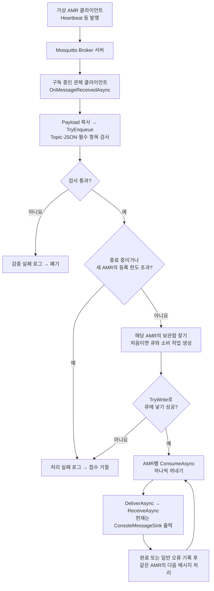
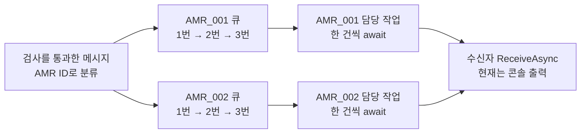

# 실제 MQTT 수신 코드 읽기

가상 AMR을 **택배 발송자**, Mosquitto Broker를 **택배 중계소**, 관제의 수신 코드를 **접수·분류소**라고 생각하면 됩니다. AMR별 큐는 **각 AMR 전용 보관함**이고, `ConsumeAsync`는 그 보관함에서 하나씩 꺼내 처리하는 **담당 작업**입니다.

AMR과 관제는 모두 MQTT 클라이언트입니다. 서버 역할은 Docker의 Mosquitto가 맡습니다. 아래 흐름은 실제 수신 모드에서 실행되는 제품 코드이며 테스트 코드를 거치지 않습니다.

## 전체 수신 순서도

접수 콜백은 검사·큐 접수 또는 거절을 마치면 `Task.CompletedTask`를 반환합니다. 위 그림의 큐 이후 처리는 별도의 소비 작업이 맡으므로 접수 콜백이 끝나기 전이나 후에 실행될 수 있습니다. `CompletedTask`는 Core 처리 완료나 AMR에 보내는 ACK를 뜻하지 않습니다. 종료 취소를 받으면 다음 메시지로 진행하는 대신 소비 작업을 끝내고 남은 큐를 폐기합니다.

## 읽을 세 부분

1. [MqttSubscriber.cs — OnMessageReceivedAsync](MqttSubscriber.cs): 접수 창구입니다. 생성자의 `ApplicationMessageReceivedAsync += ...`가 실제 MQTT 도착 알림과 메서드를 연결합니다. Topic은 주소, Payload는 내용이며 `ToArray()`로 내용을 복사합니다.
2. [AmrMessageDispatcher.cs — TryEnqueue](AmrMessageDispatcher.cs): 검사 후 AMR ID로 보관함을 찾습니다. 처음 보는 ID일 때만 `Worker`와 `Task.Run(() => ConsumeAsync(worker))`를 만듭니다. 같은 AMR의 다음 메시지는 기존 보관함으로 들어갑니다.
3. [AmrMessageDispatcher.cs — ConsumeAsync](AmrMessageDispatcher.cs): 보관함을 하나씩 비우는 작업입니다. `await _processor.DeliverAsync(...)`로 한 건의 처리가 끝날 때까지 기다린 뒤 다음 건을 꺼냅니다.

중괄호는 코드 묶음의 시작과 끝입니다. 나머지 주요 선언·조건·호출에는 소스에서 바로 읽을 수 있도록 줄별 주석을 달았습니다. 종료와 보관함 설정도 같은 파일 아래쪽에서 설명합니다.

## 두 AMR이 들어오면

AMR_001의 1번 처리가 기다리는 중이면 같은 AMR의 2번은 기다립니다. AMR_002는 별도의 작업이므로 AMR_001의 완료를 기다리지 않고 처리할 수 있습니다. 두 작업은 같은 수신자 객체를 호출하므로, 나중에 연결할 실제 Core도 여러 AMR의 동시 호출을 처리할 수 있어야 합니다.

**작업(Task)은 전용 스레드와 다릅니다.** `Task.Run`은 스레드 풀에 작업을 맡깁니다. `await`는 기다리는 작업이 아직 끝나지 않았을 때 해당 메서드를 잠시 멈추고 스레드를 돌려줄 수 있게 합니다. 완료된 작업을 await하면 바로 이어집니다. `async`라는 단어만 붙인다고 자동으로 독립 처리되는 것은 아닙니다.

`lock`은 명부 확인·큐 생성·접수 동안 짧게 사용합니다. 검사와 접수는 동기적으로 진행하며, 오래 걸릴 수 있는 수신자 처리를 AMR별 작업으로 분리한 구조입니다. 서로 다른 AMR의 전체 도착 순서나 정확한 실행 시각을 보장하는 구조는 아닙니다.

## 실제 실행과 테스트의 연결

[콘솔 Program.cs](../../Amr.Communication.Console/Program.cs)에서 `IncomingMessageProcessor(new ConsoleMessageSink(), ...)`와 수신용 `MqttConnectionManager`를 만듭니다. [MqttClientService.cs](MqttClientService.cs)가 `MqttSubscriber`를 만들고, 구독한 메시지가 도착하면 위 흐름이 시작됩니다. 수신 모드 또는 명령 실행 모드에서 사용하는 경로입니다. 연결만 확인하는 모드에서는 수신자를 만들지 않습니다.

[IncomingMessageProcessor.cs](../Validation/IncomingMessageProcessor.cs)의 `DeliverAsync`는 `_core.ReceiveAsync(...)`를 호출합니다. 필드 이름이 `_core`여도 현재 콘솔에서 주입하는 구현은 `ConsoleMessageSink`입니다. 지금 실제 처리의 끝은 콘솔 출력이며 Core 업무 처리·장비 이동 완료를 의미하지 않습니다.

[AmrMessageDispatcherTests.cs](../../../tests/Amr.Communication.Tests/AmrMessageDispatcherTests.cs)는 이 제품 클래스를 호출해 검사하는 별도 코드입니다. 예를 들어 AMR_001의 처리만 일부러 기다리게 하고 그동안 AMR_002가 처리되는지 확인합니다. 프로그램이 평소 실행될 때 테스트가 함께 실행되는 것은 아닙니다.

큐 크기·과부하 거절·취소에 대한 정확한 개발용 정책은 [RECEIVE_QUEUE.md](RECEIVE_QUEUE.md)를 참고합니다. 이번 설명 추가는 동작 변경이나 새 실행 검증 결과가 아닙니다.
